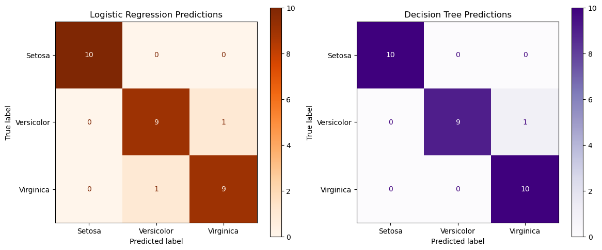
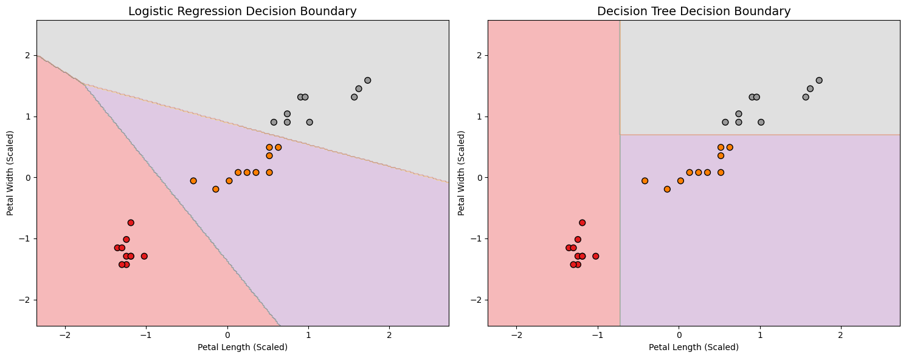

## Introduction

This respository will contain documentation and code for tasks completed as part of my DATHEON internship program.

Tasks will cover a wide range of Data Science and Machine Learning problems utilizing common tools and libraries including notebooks.

## Content and Structure

<pre>
.
├── task-1-iris/    # Project task covering classification on iris data
├── task-2          # This will contain project task on housing price prediction
├── .gitignore      # Files excluded from version control
└── README.md       # This file
</pre>

## Highlights

This section will feature summaries and highlights from the different project tasks. Each `task` directory has its own detailed documentation with the details.

### Iris Classification

Confusion Matrix

Decision Boundary Visualization

Find details here: [Iris Classification README](./task-1-iris/README.md)

## Usage Information and License

This project is for educational purposes only. Feel free to use and share.

## Author

- GitHub: @Mohammed-Hanan-Othman
