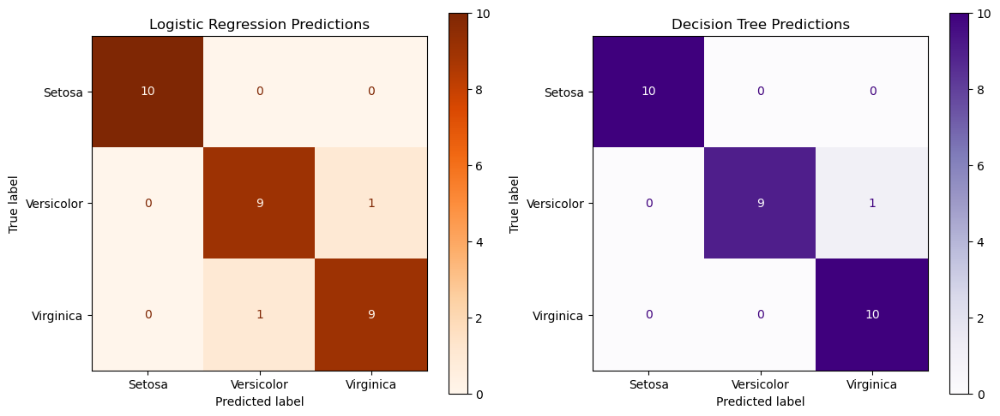
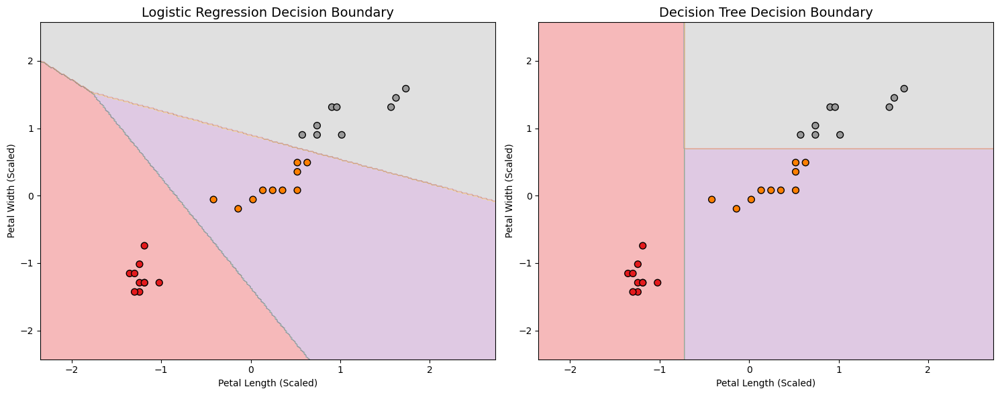

# 📈📉 Multi-Class Benchmark Classification

This project focuses on building and implementing a supervised classification model on the Iris dataset. Two models, a logistic regression and a decision tree classifier are built to classify flowers into species given floral data (on sepals and petals).

The analysis and modeling are conducted using Python in a Jupyter Notebook, with final models saved in the `models/` folder for future use and evaluation.

## 📁 Project Structure

<pre>
.
├── data/ # Dataset used (in .csv format) 
├── images/ # Model related screenshots
│ └── confusion-matrix.png
│ └── decision-boundary.png
├── models/ # Saved trained models (pickle files)
├── notebooks/ # Jupyter Notebook for exploration and model building
│ └── iris-classification.ipynb
└── README.md # This file
</pre>

## 📊 Dataset

The dataset includes various features influencing flower species. The columns:

- `sepal_length`: The length of the sepal of the flower
- `sepal_width`: The width of the sepal of the flower
- `petal_length`: The length of the petal of the flower
- `petal_width`: The width of the petal of the flower
- `species`: The target variable (Species of the flower).

Refer to the `data/` folder for details

## 🚀 How to Run

1. **Clone the repository:**

```bash
git clone https://github.com/Mohammed-Hanan-Othman/datheon.git
cd datheon/task-1-iris
```

2. **Installation and Setup:**
   This assumes an anaconda environment.

3. **Open notebook**

```bash
jupyter notebook notebooks/iris-classification.ipynb
```

4. **Run:**
   - Run all cells to reproduce the results.
   - Alternatively, create a new `.py` file and load the saved models from the `.models/` folder to make predictions.

## 🧠 Model Overview

Different models are considered as per the project:

1. **Logistic Regression Model:**
   - 📈 Model results and metrics
     - Accuracy: 0.93
     - Precision: 0.93
     - Recall: 0.93
     - f1 score: 0.93
   - Model Output: Model trained and saved as a `.pkl` file in `.models/` folder.

1. **Decison Tree Model:**
   - 📈 Model results and metrics
     - Accuracy: 0.97
     - Precision: 0.97
     - Recall: 0.97
     - f1 score: 0.97
   - Model Output: Model trained and saved as a `.pkl` file in `.models/` folder.

### Model Screenshots

1. **Confusion Matix:**
   

1. **Decision Bounday Visualization:**

   This uses the datasets' strongly correlated featues, `petal_length` and `petal_width`.

   

## 📄 License

This project is for educational purposes only. Feel free to use and share.

## 👨‍💻 Author

- GitHub: @Mohammed-Hanan-Othman
